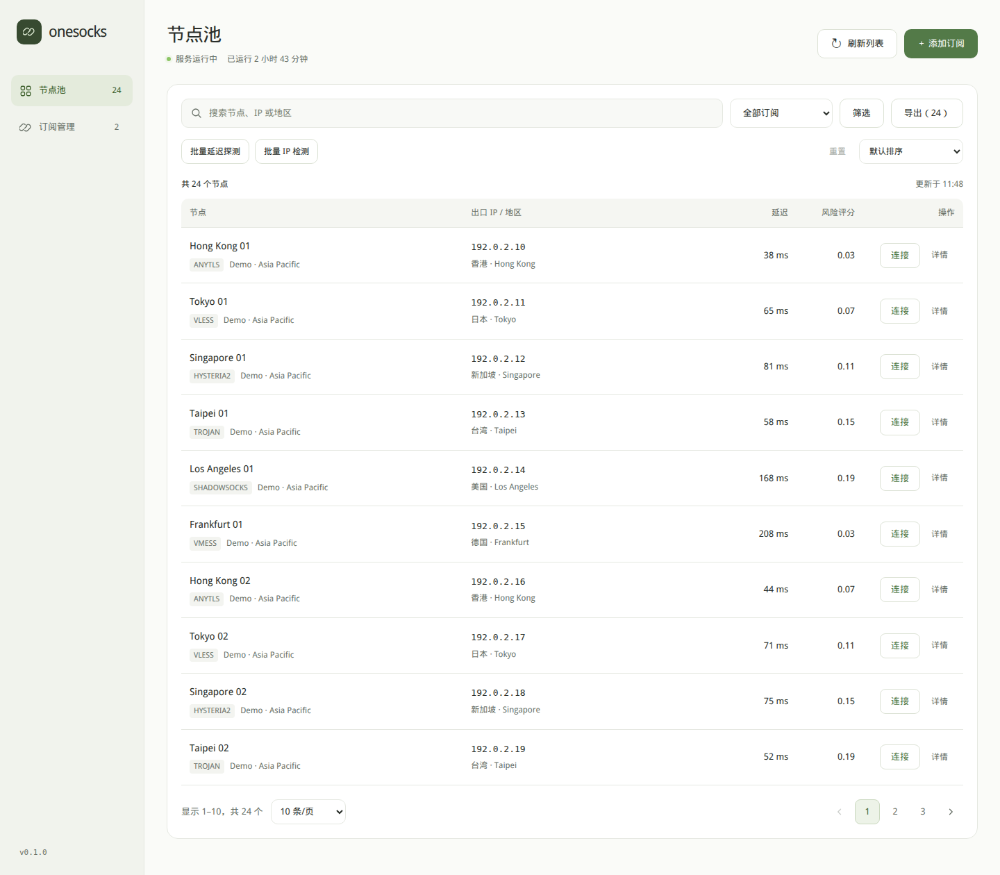
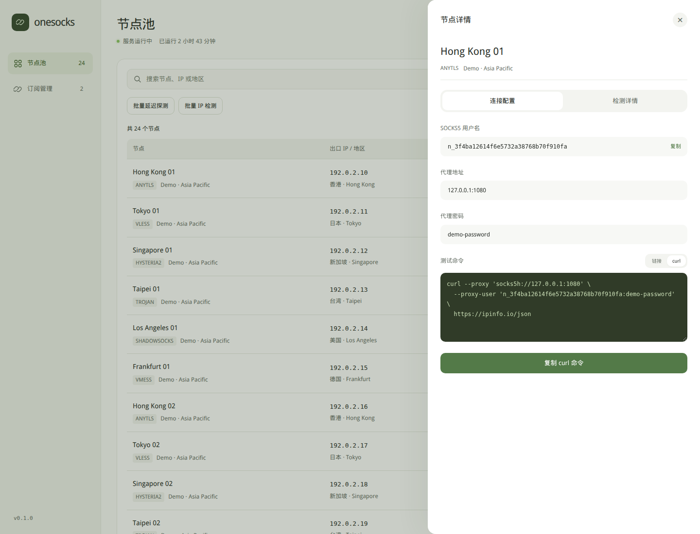

# OneSocks

**English** · [简体中文](README.zh-CN.md)

One SOCKS5 endpoint for all your proxy subscriptions. Choose an outbound node with the SOCKS5 username.

OneSocks is a single Go binary with an embedded Web UI, a sing-box protocol engine, and SQLite storage. No separate frontend or database service is required.

[Download](https://github.com/wangsendi/onesocks/releases/latest) · [Container image](https://github.com/wangsendi/onesocks/pkgs/container/onesocks) · [Docker setup](#docker-linux)



*Real application UI with fictional demonstration data. The Web UI currently uses Simplified Chinese.*

## Features

- Manage multiple subscriptions with scheduled and manual refreshes.
- Select a node by its stable ID or unique full name, using a single SOCKS5 port.
- Forward TCP and SOCKS5 UDP, including QUIC / HTTP/3 when the client and upstream node support UDP.
- Probe HTTP latency, exit IP, location, and IP risk, with a shared concurrency limit and streamed batch results.
- Search, filter, sort, paginate, and export nodes as CSV, SOCKS5 links, or JSON.
- Keep subscriptions, nodes, and probe results across restarts in SQLite.

Supported imports: **sing-box JSON**, **URI lists**, and **Base64-encoded URI lists**. Supported node protocols include **Shadowsocks, VLESS, VMess, Trojan, Hysteria2, and AnyTLS**, with TLS, Reality, WebSocket, and gRPC where applicable. Clash YAML, chained outbounds, and imported listener/routing/DNS configurations are not supported.

## Quick start

### Download a binary

Download the archive matching your OS and CPU from [Releases](https://github.com/wangsendi/onesocks/releases/latest). Linux and macOS use `.tar.gz`; Windows uses `.zip`. Both amd64 and arm64 builds are provided, with `checksums.txt` for SHA-256 verification.

Extract the archive, open its directory, and run:

```bash
./onesocks -config config.yaml
# Windows PowerShell: .\onesocks.exe -config config.yaml
```

Open **<http://127.0.0.1:8080>**, add a subscription, then click **连接** (Connect) on a node to copy its SOCKS5 link or curl command. The bundled config listens on `127.0.0.1:1080` for SOCKS5 and `127.0.0.1:8080` for the UI/API.

### Docker (Linux)

Images: `ghcr.io/wangsendi/onesocks:latest` or a pinned tag such as `:v0.1.0`, for **linux/amd64** and **linux/arm64**.

```bash
mkdir onesocks && cd onesocks
curl -fsSLO https://raw.githubusercontent.com/wangsendi/onesocks/main/compose.yaml
curl -fsSL https://raw.githubusercontent.com/wangsendi/onesocks/main/configs/config.docker.yaml -o config.yaml
# Edit config.yaml if needed, then start:
docker compose up -d
docker compose logs -f
```

Open **<http://127.0.0.1:8080>** on the Docker host. The default config only permits local access. For remote access, change the listener addresses to an appropriate host IP or `0.0.0.0`, set `socks_password` and `api_token`, and restrict access with your firewall. The UI/API exposes subscription URLs and node credentials.

The Compose file uses **host networking**. SOCKS5 UDP allocates a different temporary relay port for each session; publishing only `1080/tcp`, `1080/udp`, and `8080/tcp` on a bridge network does **not** expose those relay ports. Remote clients must be able to reach the returned host address and UDP port. These instructions target Docker Engine on Linux; Docker Desktop networking does not provide the same guarantees. Native binaries are the recommended starting point on macOS and Windows.

The named volume `onesocks-data` stores the database in `/var/lib/onesocks`. Keep this `data_dir` when using the supplied mounts. Restart after editing the config; `docker compose down` preserves the volume, while `down -v` deletes it.

Without Compose, after downloading `config.yaml` as above:

```bash
docker run -d --name onesocks --restart unless-stopped \
  --network host \
  --mount type=bind,src="$(pwd)/config.yaml",dst=/etc/onesocks/config.yaml,readonly \
  --mount type=volume,src=onesocks-data,dst=/var/lib/onesocks \
  ghcr.io/wangsendi/onesocks:latest
```

Upgrade with `docker compose pull && docker compose up -d`. Set `ONESOCKS_VERSION=v0.1.0` in a `.env` file next to `compose.yaml` to pin a version. The container runs as UID/GID `65532`; if you replace the named volume with a bind mount, make that directory writable by this user.

### Build from source

Use **Go 1.27 or later** (the release toolchain), and run from the repository root:

```bash
make build
./bin/onesocks
```

Without `-config`, program defaults are used: SOCKS5 on `127.0.0.1:1080`, UI/API on `127.0.0.1:8080`, and data in `./data`. To customize settings, create `config.yaml` using the example below and pass `-config config.yaml`.

```bash
# Build a local container image instead:
docker build --build-arg VERSION=dev -t onesocks:local .
```

## Connect through a node

The Web UI provides connection details and copyable commands:



*All addresses, nodes, and credentials shown here are demonstration data.*

For API-based setup, add a subscription and list its nodes:

```bash
curl -X POST http://127.0.0.1:8080/api/subscriptions \
  -H 'Content-Type: application/json' \
  -d '{"name":"My subscription","url":"https://example.com/subscription","refresh_interval":"6h"}'

curl http://127.0.0.1:8080/api/nodes
```

Replace `NODE_USERNAME` with `items[].username` from that response:

```bash
curl --proxy socks5h://127.0.0.1:1080 \
  --proxy-user 'NODE_USERNAME:anything' \
  --max-time 30 https://ipinfo.io/json
```

SOCKS5 username/password authentication is required. If `socks_password` is empty, any **nonempty** password is accepted; otherwise use the configured password. No-auth SOCKS5 clients cannot select a node.

A node ID is `n_` followed by `MD5(subscription_id + "\x00" + original_node_name)`. Renaming the subscription or updating node settings preserves the ID; renaming the original node changes it. Duplicate original names within one subscription keep the last entry. A unique full display name, such as `My subscription-Tokyo 01`, also works as a username if it fits within 255 bytes.

## Configuration

```yaml
socks_listen: 127.0.0.1:1080
api_listen: 127.0.0.1:8080
data_dir: data
socks_password: ""
api_token: ""
probe_concurrency: 16
outbound_interface: ""
```

| Setting | Default | Meaning |
| --- | --- | --- |
| `socks_listen` | `127.0.0.1:1080` | SOCKS5 listening address |
| `api_listen` | `127.0.0.1:8080` | Web UI and API listening address |
| `data_dir` | `data` | Directory containing `onesocks.db` |
| `socks_password` | empty | Shared SOCKS5 password; empty accepts any nonempty password |
| `api_token` | empty | API Bearer token; empty disables API authentication |
| `probe_concurrency` | `16` | Positive integer; shared limit across individual and batch probes |
| `outbound_interface` | empty | Bind outbound connections to an interface; empty uses system routing |

Relative paths are resolved from the working directory. Config changes require a restart. With `api_token` set, sign in to the Web UI with the token and add this header to API calls:

```bash
curl -H 'Authorization: Bearer YOUR_TOKEN' http://127.0.0.1:8080/api/nodes
```

The UI and API return full subscription URLs, outbound configurations, and service settings, including credentials. Use authenticated, restricted access when exposing the service beyond localhost.

`outbound_interface` applies to node connections, node DNS lookups, and subscription downloads. When running beside a TUN client, choose your physical interface, such as `eth0`, if needed. Interface binding depends on OS permissions and routing; a DNS server returning Fake-IP addresses may also require DNS exclusions or changes.

## Probes and exports

**HTTP latency** sends HEAD requests through the selected node to Cloudflare, preferring the second request over a reused connection. **IP checks** query [iplogs](https://iplogs.com/) through the node for exit IP, location, network details, and risk evidence. Risk scores range from 0 to 1; higher values indicate stronger evidence of proxy use.

These are diagnostic checks, **not upload/download speed tests**. They use TCP and do not establish UDP availability.

Batch probes and exports apply to **all filtered nodes**, including other pages. The shared concurrency limit defaults to 16; excess work waits in a cancellable queue. Results arrive as each node finishes, and a failed node does not stop the rest. Closing the batch request cancels its running and queued work. Results are saved to SQLite and cleared when a node's outbound configuration changes.

## HTTP API

Requests and responses use JSON; list responses contain `items`. Batch probes return NDJSON.

| Method | Path | Purpose |
| --- | --- | --- |
| GET | `/api/subscriptions` | List subscriptions and refresh status |
| POST | `/api/subscriptions` | Add and immediately fetch a subscription |
| PATCH | `/api/subscriptions/{id}` | Update name, URL, or refresh interval |
| POST | `/api/subscriptions/{id}/refresh` | Refresh a subscription |
| DELETE | `/api/subscriptions/{id}` | Delete a subscription and its nodes |
| GET | `/api/nodes` | List nodes; optional `subscription_id` filter |
| POST | `/api/nodes/{id}/latency` | Probe HTTP latency |
| POST | `/api/nodes/{id}/ip-check` | Probe exit IP and risk |
| POST | `/api/nodes/probe` | Stream batch probe results |
| GET | `/api/status` | Version, readiness, uptime, and counts |
| GET | `/api/config` | Current service configuration |

```bash
curl -N -X POST http://127.0.0.1:8080/api/nodes/probe \
  -H 'Content-Type: application/json' \
  -d '{"ids":["NODE_ID"],"kind":"latency"}'
```

`kind` is `latency` or `ip-check`. Each line contains `id` and either `node` or `error`; probe failures can also appear in `node.latency.error` or `node.ip_check.error`. Latency probes have a 5-second limit, IP probes 40 seconds, and each stream write 30 seconds. Batch streams are exempt from the normal 3-minute API deadline.

Subscriptions refresh every 6 hours unless configured otherwise. URL fragments are removed before storage and fetching. Failed refreshes preserve the last successful nodes. On startup, saved nodes are restored before subscriptions refresh in the background.

## TCP, UDP, and QUIC

TCP CONNECT and UDP ASSOCIATE run in the **same process**; SOCKS5 BIND is not supported. For UDP, the client authenticates over TCP, keeps that control connection open, and sends SOCKS5-encapsulated datagrams to the returned UDP relay address. UDP payloads do not travel over that TCP control connection. The transport to the upstream proxy depends on its protocol; for example, AnyTLS encapsulates UDP over its own stream transport.

QUIC / HTTP/3 requires UDP support in **both the client and the selected node**. A TCP-only SOCKS5 client does not gain UDP support automatically. Each association uses an ephemeral UDP port, which must be reachable by the client, including through any container networking, NAT, or firewall.

UDP associations and destination connections expire after 2 minutes of inactivity. Each association allows up to 128 destinations, with 8 queued packets per destination. Packets beyond these limits and SOCKS5 fragments are dropped.

## Development and releases

```bash
make test
make race
go vet -tags with_utls ./...
make build VERSION=v0.1.0
bash scripts/package.sh v0.1.0 linux amd64
```

Builds use `with_utls` for uTLS and Reality. UI assets are embedded using `go:embed`; rebuild and restart after changing them.

Pushing a `v*` version tag runs the [release workflow](https://github.com/wangsendi/onesocks/blob/main/.github/workflows/release.yml): tests, six platform archives, SHA-256 checksums, multi-architecture GHCR images, and a GitHub Release. Publishing uses the repository's automatic `GITHUB_TOKEN` with `contents: write` and `packages: write`; no separate registry secret is needed. For a newly created GHCR package, the repository owner may need to set its visibility to **Public** in package settings to allow anonymous pulls.

## License

See [LICENSE](LICENSE). The proxy engine is [sing-box](https://github.com/SagerNet/sing-box); dependency licenses also apply when distributing builds.
