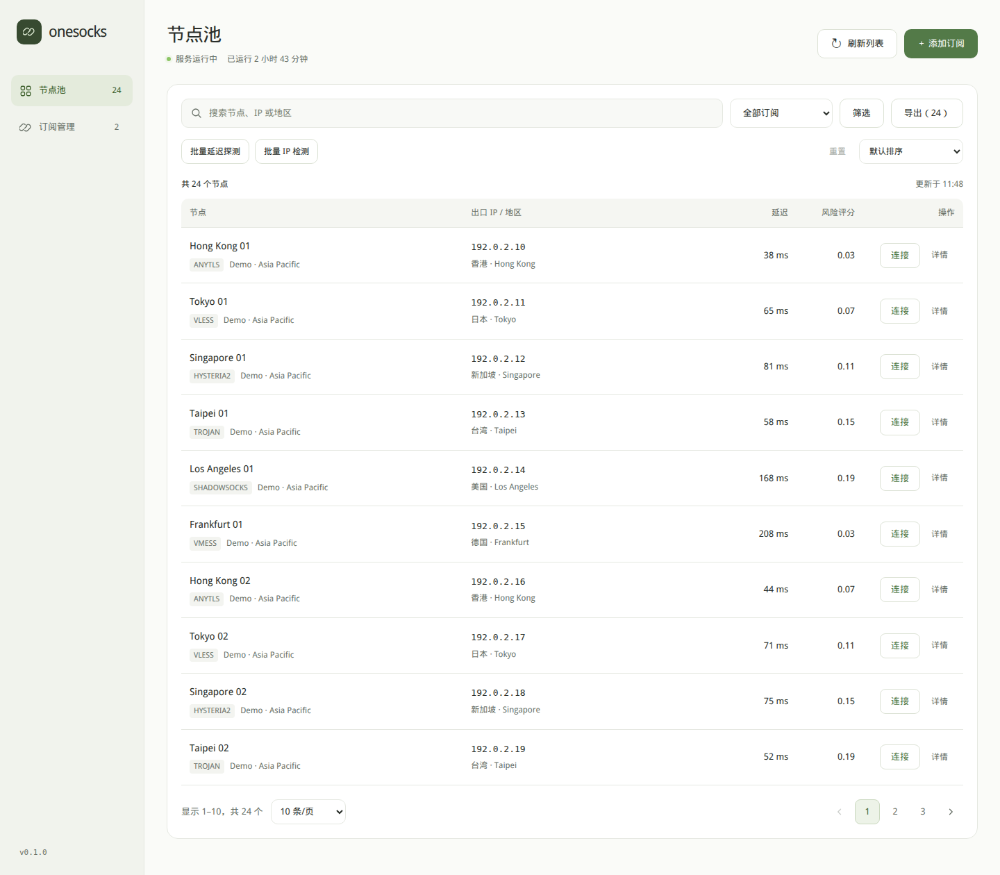
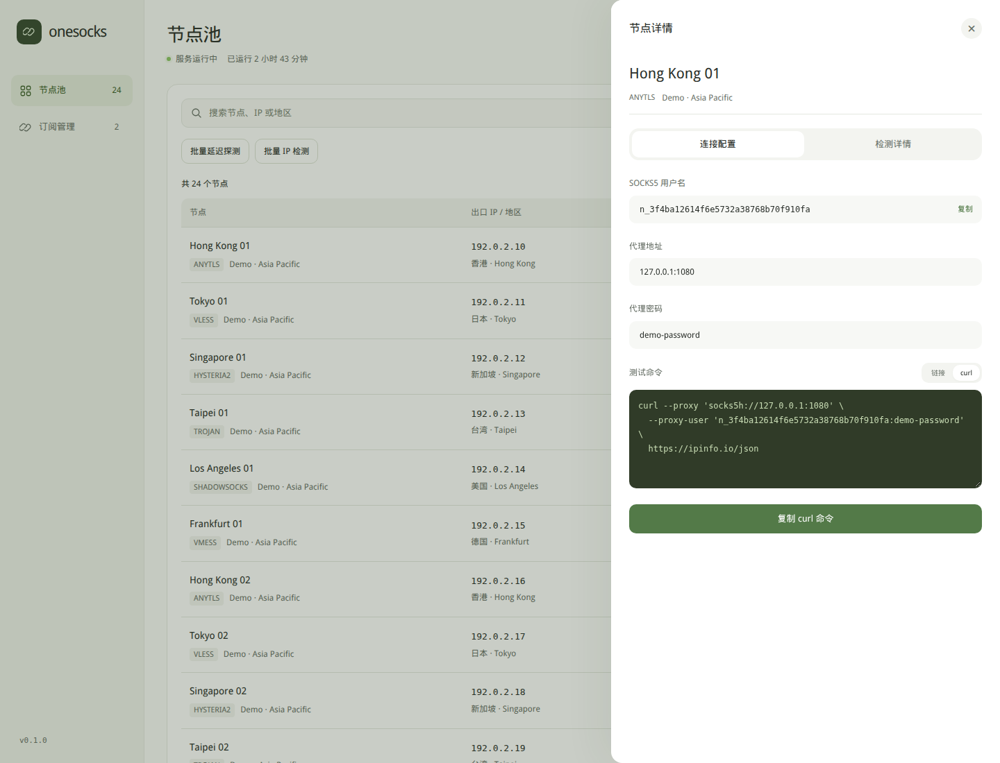

# OneSocks

[English](README.md) · **简体中文**

将多个代理订阅聚合到一个 SOCKS5 端口，通过用户名选择出站节点。

OneSocks 使用 Go 编写，内嵌 Web 管理界面和 sing-box 协议引擎，使用 SQLite 存储数据，无需单独部署前端或数据库服务。

[下载安装包](https://github.com/wangsendi/onesocks/releases/latest) · [容器镜像](https://github.com/wangsendi/onesocks/pkgs/container/onesocks) · [Docker 部署](#dockerlinux)



*截图来自实际管理界面，节点和检测结果均为虚构的演示数据。管理界面目前使用简体中文。*

## 功能

- 管理多个订阅，支持定时刷新和手动刷新。
- 使用稳定的节点 ID 或唯一完整名称作为用户名，通过同一个 SOCKS5 端口选择节点。
- 转发 TCP 和 SOCKS5 UDP；客户端和节点支持 UDP 时，可承载 QUIC / HTTP/3。
- 检测 HTTP 延迟、出口 IP、位置和 IP 风险，支持共享并发上限及流式批量检测。
- 搜索、组合筛选、排序、分页，导出 CSV、SOCKS5 链接或 JSON。
- 使用 SQLite 保存订阅、节点及检测结果，重启后恢复。

订阅支持 **sing-box JSON、URI 列表和 Base64 编码的 URI 列表**。支持的节点协议包括 **Shadowsocks、VLESS、VMess、Trojan、Hysteria2 和 AnyTLS**，以及相应协议的 TLS、Reality、WebSocket 和 gRPC 配置。不支持 Clash YAML、链式出站，也不导入订阅中的监听、路由和完整 DNS 配置。

## 快速开始

### 下载安装包

从 [Releases](https://github.com/wangsendi/onesocks/releases/latest) 下载对应系统与 CPU 架构的安装包。Linux 和 macOS 使用 `.tar.gz`，Windows 使用 `.zip`，均提供 amd64 和 arm64 构建，并附带 `checksums.txt` 用于 SHA-256 校验。

解压并进入目录后运行：

```bash
./onesocks -config config.yaml
# Windows PowerShell：.\onesocks.exe -config config.yaml
```

打开 **<http://127.0.0.1:8080>**，添加订阅，点击节点的“连接”按钮即可复制 SOCKS5 链接或 curl 命令。安装包中的配置默认使用 `127.0.0.1:1080` 提供 SOCKS5，使用 `127.0.0.1:8080` 提供管理界面和 API。

### Docker（Linux）

镜像为 `ghcr.io/wangsendi/onesocks:latest`，也可固定版本，例如 `:v0.1.0`。支持 **linux/amd64** 和 **linux/arm64**。

```bash
mkdir onesocks && cd onesocks
curl -fsSLO https://raw.githubusercontent.com/wangsendi/onesocks/main/compose.yaml
curl -fsSL https://raw.githubusercontent.com/wangsendi/onesocks/main/configs/config.docker.yaml -o config.yaml
# 按需编辑 config.yaml，然后启动：
docker compose up -d
docker compose logs -f
```

在 Docker 宿主机打开 **<http://127.0.0.1:8080>**。默认只允许本机访问。如需远程访问，将监听地址改成适当的宿主机 IP 或 `0.0.0.0`，设置 `socks_password` 和 `api_token`，并通过防火墙限制访问范围。管理界面和 API 会返回完整订阅地址和节点凭据。

Compose 使用 **host 网络模式**。SOCKS5 UDP 为每个会话分配临时中继端口；在 bridge 网络下只映射 `1080/tcp`、`1080/udp` 和 `8080/tcp`，**无法**开放这些临时端口。远程客户端必须能访问协商返回的宿主机地址和 UDP 端口。此部署方式面向 Linux Docker Engine，Docker Desktop 的网络行为并不相同；macOS 和 Windows 建议先使用原生安装包。

命名卷 `onesocks-data` 将数据库持久化到 `/var/lib/onesocks`。使用附带的挂载配置时，请保留这一 `data_dir`。修改配置后需重启；`docker compose down` 保留数据卷，`down -v` 会删除数据卷。

不使用 Compose 时，先按上面的方式下载 `config.yaml`，再运行：

```bash
docker run -d --name onesocks --restart unless-stopped \
  --network host \
  --mount type=bind,src="$(pwd)/config.yaml",dst=/etc/onesocks/config.yaml,readonly \
  --mount type=volume,src=onesocks-data,dst=/var/lib/onesocks \
  ghcr.io/wangsendi/onesocks:latest
```

使用 `docker compose pull && docker compose up -d` 升级。在 `compose.yaml` 同目录的 `.env` 文件中设置 `ONESOCKS_VERSION=v0.1.0` 可固定版本。容器以 UID/GID `65532` 运行；改用宿主机目录挂载数据时，需保证该用户对目录有写权限。

### 从源码构建

使用 **Go 1.27 或更新版本**（发布使用的工具链），在仓库根目录执行：

```bash
make build
./bin/onesocks
```

不传 `-config` 时使用程序默认值：SOCKS5 为 `127.0.0.1:1080`，管理界面和 API 为 `127.0.0.1:8080`，数据保存在 `./data`。需要自定义时，按下方配置示例创建 `config.yaml`，并通过 `-config config.yaml` 启动。

```bash
# 也可以自行构建容器镜像：
docker build --build-arg VERSION=dev -t onesocks:local .
```

## 使用节点

管理界面提供连接配置和可复制的命令：



*截图中的地址、节点与密码均为演示数据。*

也可以通过 API 添加订阅并获取节点列表：

```bash
curl -X POST http://127.0.0.1:8080/api/subscriptions \
  -H 'Content-Type: application/json' \
  -d '{"name":"我的订阅","url":"https://example.com/subscription","refresh_interval":"6h"}'

curl http://127.0.0.1:8080/api/nodes
```

将 `NODE_USERNAME` 替换为响应中 `items[].username` 的值：

```bash
curl --proxy socks5h://127.0.0.1:1080 \
  --proxy-user 'NODE_USERNAME:anything' \
  --max-time 30 https://ipinfo.io/json
```

SOCKS5 必须使用用户名/密码认证。`socks_password` 留空时接受任意**非空**密码，设置后则需使用配置中的密码。仅支持无认证模式的 SOCKS5 客户端无法选择节点。

节点 ID 为 `n_` 加 `MD5(subscription_id + "\x00" + 原节点名)`。订阅改名或节点配置更新不会改变 ID，原节点改名会生成新 ID。同一订阅中名称重复的节点保留最后一条。唯一的完整展示名称（例如 `我的订阅-Tokyo 01`）也可作为用户名，但不能超过 255 字节。

## 配置

```yaml
socks_listen: 127.0.0.1:1080
api_listen: 127.0.0.1:8080
data_dir: data
socks_password: ""
api_token: ""
probe_concurrency: 16
outbound_interface: ""
```

| 配置项 | 默认值 | 说明 |
| --- | --- | --- |
| `socks_listen` | `127.0.0.1:1080` | SOCKS5 监听地址 |
| `api_listen` | `127.0.0.1:8080` | 管理界面和 API 监听地址 |
| `data_dir` | `data` | `onesocks.db` 所在目录 |
| `socks_password` | 空 | 共用 SOCKS5 密码；留空接受任意非空密码 |
| `api_token` | 空 | API Bearer 令牌；留空关闭 API 鉴权 |
| `probe_concurrency` | `16` | 正整数；单节点和所有批量检测共享的并发上限 |
| `outbound_interface` | 空 | 出站网卡；留空使用系统路由 |

相对路径以工作目录为基准，修改配置后需重启。设置 `api_token` 后，管理界面需要输入令牌，API 请求需要携带认证头：

```bash
curl -H 'Authorization: Bearer YOUR_TOKEN' http://127.0.0.1:8080/api/nodes
```

管理界面和 API 返回完整订阅 URL、节点出站配置及服务配置，包括凭据。对本机以外提供服务时，请启用鉴权并限制访问范围。

`outbound_interface` 用于节点连接、节点 DNS 解析和订阅下载。与 TUN 客户端共存时，可按需指定实际物理网卡，例如 `eth0`。接口绑定取决于系统权限和路由；若 DNS 返回 Fake-IP 地址，还需调整 DNS 或添加排除规则。

## 检测和导出

**HTTP 延迟**通过所选节点向 Cloudflare 发送 HEAD 请求，优先记录复用连接后的第二次响应耗时。**IP 检测**通过节点请求 [iplogs](https://iplogs.com/)，获取出口 IP、位置、网络信息及风险证据。评分范围为 0–1，数值越高表示代理使用证据越强。

这些是诊断功能，**不是上传/下载测速**。检测使用 TCP，也不能据此判断 UDP 是否可用。

批量检测和导出作用于**筛选后的全部节点**，包含其他分页的结果。共享并发上限默认为 16，超出部分进入可取消的队列。结果按完成顺序返回，单个节点失败不影响其余节点。关闭批量请求会取消运行中及排队中的任务。检测结果保存到 SQLite；节点出站配置发生变化时会清除旧结果。

## HTTP API

请求和响应使用 JSON，列表通过 `items` 字段返回，批量检测使用 NDJSON。

| 方法 | 路径 | 说明 |
| --- | --- | --- |
| GET | `/api/subscriptions` | 获取订阅列表及刷新状态 |
| POST | `/api/subscriptions` | 添加并立即拉取订阅 |
| PATCH | `/api/subscriptions/{id}` | 修改名称、URL 或刷新间隔 |
| POST | `/api/subscriptions/{id}/refresh` | 刷新订阅 |
| DELETE | `/api/subscriptions/{id}` | 删除订阅及其节点 |
| GET | `/api/nodes` | 获取节点，可通过 `subscription_id` 筛选 |
| POST | `/api/nodes/{id}/latency` | 检测 HTTP 延迟 |
| POST | `/api/nodes/{id}/ip-check` | 检测出口 IP 和风险 |
| POST | `/api/nodes/probe` | 流式批量检测 |
| GET | `/api/status` | 获取版本、就绪状态、运行时长和数量 |
| GET | `/api/config` | 获取当前服务配置 |

```bash
curl -N -X POST http://127.0.0.1:8080/api/nodes/probe \
  -H 'Content-Type: application/json' \
  -d '{"ids":["NODE_ID"],"kind":"latency"}'
```

`kind` 可选 `latency` 或 `ip-check`。每行包含 `id` 及 `node` 或 `error`；检测失败原因也可能保存在 `node.latency.error` 或 `node.ip_check.error` 中。延迟检测限时 5 秒，IP 检测 40 秒，每次流式写入最多等待 30 秒。批量流不受普通 API 的 3 分钟总时限限制。

订阅默认每 6 小时刷新，URL 的片段标签在保存和请求前移除。刷新失败时保留上次成功的节点。启动时先恢复保存的节点，再在后台刷新订阅。

## TCP、UDP 与 QUIC

TCP CONNECT 和 UDP ASSOCIATE 由**同一个进程**处理，不支持 SOCKS5 BIND。UDP 客户端先通过 TCP 认证，并保持这条控制连接，再向返回的 UDP 中继地址发送带 SOCKS5 头的数据包。UDP 数据不经过这条 TCP 控制连接。到上游代理的传输方式取决于节点协议，例如 AnyTLS 使用自己的流式传输封装 UDP。

QUIC / HTTP/3 要求**客户端和所选节点都支持 UDP**。仅支持 TCP 的 SOCKS5 客户端不会自动获得 UDP 能力。每个会话使用临时 UDP 端口，客户端必须能够访问该端口；部署容器、NAT 或防火墙时也需要满足这一条件。

UDP 会话及目标连接空闲 2 分钟后回收。每个会话最多保留 128 个目标，每个目标最多排队 8 个数据包。超出限制的包和 SOCKS5 分片包会被丢弃。

## 开发和发布

```bash
make test
make race
go vet -tags with_utls ./...
make build VERSION=v0.1.0
bash scripts/package.sh v0.1.0 linux amd64
```

构建使用 `with_utls` 支持 uTLS 和 Reality。界面静态资源通过 `go:embed` 内嵌，修改后需要重新构建并重启。

推送 `v*` 版本标签会触发[发布工作流](https://github.com/wangsendi/onesocks/blob/main/.github/workflows/release.yml)：运行测试、打包六个平台、生成 SHA-256 校验文件、上传多架构 GHCR 镜像并创建 GitHub Release。发布使用仓库自动提供的 `GITHUB_TOKEN`，权限为 `contents: write` 和 `packages: write`，无需单独配置镜像仓库密钥。首次创建 GHCR Package 后，仓库所有者可能需要在 Package 设置中将可见性改为 **Public**，才能匿名拉取镜像。

## 许可证

见 [LICENSE](LICENSE)。代理引擎使用 [sing-box](https://github.com/SagerNet/sing-box)，分发构建产物时也需遵守依赖的许可证。
