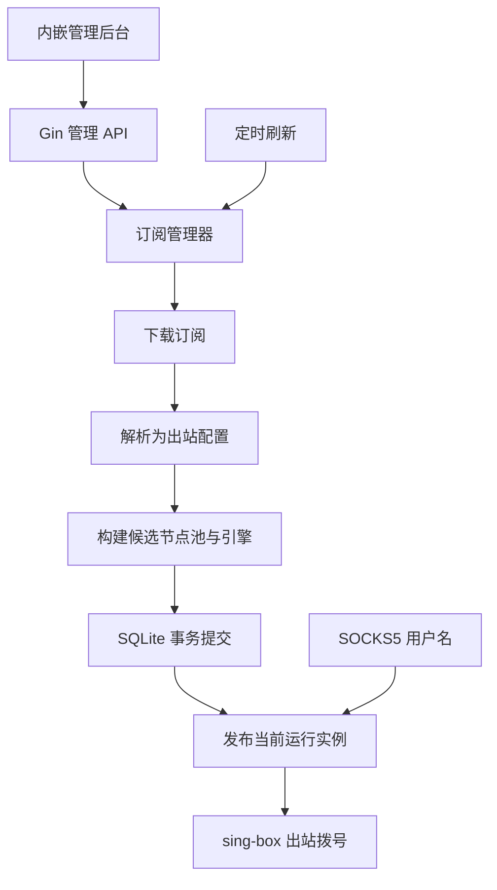

# OneSocks 架构

本文描述当前实现。启动、API 和配置用法见 [README](../README.md)，SQLite 表结构与查询示例见 [数据存储](DATABASE.md)。

## 模块

| 目录 | 职责 |
| --- | --- |
| `cmd/onesocks` | 加载配置，组装服务，处理启动和退出 |
| `internal/api` | Gin 路由、JSON 请求和 API 鉴权 |
| `internal/webui` | 内嵌管理页面与静态资源 |
| `internal/config` | YAML 配置与默认值 |
| `internal/domain` | 节点、订阅及 API 数据类型 |
| `internal/parser` | 订阅格式识别，转换为 sing-box 出站 JSON |
| `internal/service` | 订阅拉取、刷新、节点身份及运行实例切换 |
| `internal/store` | SQLite 表结构初始化、数据读取及事务写入 |
| `internal/socks` | SOCKS5 握手、用户名选节点及 TCP 转发 |
| `internal/engine/singbox` | 嵌入 sing-box v1.14.4，构建出站并按节点拨号 |

## 数据流

订阅输入支持 sing-box JSON、节点 URI 列表及整包 Base64，协议支持 SS、VLESS、Trojan、VMess、Hysteria2、AnyTLS。只导入代理节点，订阅的监听、路由和完整 DNS 配置不导入。

Gin 处理 JSON 解码，sing-box 处理协议参数。应用保留格式转换、鉴权和必要的生命周期检查；API 请求体、订阅下载和解析不设额外的字节或节点数量上限。

管理后台与 API 共用 HTTP 监听端口，静态资源通过 `go:embed` 编译进程序。页面调用现有 API，不另建数据或更新逻辑。配置了 `api_token` 时，页面以 Bearer 令牌访问 API；`/api/config` 与其他管理接口使用相同鉴权，按原值返回配置；页面自动填入 SOCKS5 地址和密码。

## 节点身份

- 订阅 ID 为随机生成的 `s_` 加 20 位十六进制字符串，订阅改名或修改 URL 时保留。
- 节点 ID 为 `n_` 加 `MD5(subscription_id + "\x00" + 原节点名)` 的完整 32 位小写十六进制值。配置内容和条目顺序不参与身份计算。
- 订阅改名、同名节点配置更新时节点 ID 保持不变；原节点改名会改变 ID。
- 同一订阅的同名条目最后一条覆盖；相同配置、不同名字是不同节点。不同订阅独立计算身份，加载时按节点名称排序。
- 推荐使用节点 ID 作为 SOCKS5 用户名。`订阅名-原节点名` 也可使用，但需唯一且最多 255 字节。

节点 ID 保存为 `nodes.id` 主键，并有 `(subscription_id, name)` 唯一约束；SOCKS5 `username` 与 ID 相同。展示名别名在运行时构建。

## 更新与连接

新增、修改、刷新和删除通过同一个更新入口串行执行。先构建候选引擎，再在 SQLite 事务中更新目标订阅及节点、增加 `generation`，提交成功后一起发布新节点池和引擎。删除订阅通过外键级联删除节点，并在同一事务中增加版本。失败关闭候选引擎，保留原来的运行实例。已有连接持有旧实例，结束后释放，超过 5 分钟时关闭。

刷新失败保留上次成功的节点，通过独立 UPDATE 记录尝试时间和错误，不增加 `generation`。

启动先恢复本地缓存并构建引擎，再提供 SOCKS5 与 API 服务，同时后台刷新订阅。退出时停止 API 和 SOCKS5，会结束当前连接并关闭引擎。

唯一状态来源为 `data_dir/onesocks.db`。表结构由 [internal/store/schema.sql](../internal/store/schema.sql) 嵌入程序，仅支持 `PRAGMA user_version = 2`，不升级或兼容旧库。更换旧库需先停止旧进程，删除数据库及其 `-wal`、`-shm` 文件，再启动并通过 API 重加订阅、查询新的节点用户名。数据库通过单连接池启用 WAL、外键、5 秒锁等待及 FULL 同步。程序不读取或导入旧 `state.json`。

## 网络与功能边界

- SOCKS5 仅支持 TCP CONNECT；Hysteria2 出站本身仍可使用 UDP/QUIC。
- 未知用户名或拨号失败返回错误；每条连接按所选节点转发。
- `outbound_interface` 控制节点连接、节点域名解析、订阅下载及其 DNS 的接口绑定。
- 节点延迟和 IP 检测使用指定节点的租约发起 HTTP 请求；结果写入 SQLite，重启恢复，出站配置变化时失效，不自动后台探测。批量检测同时发起筛选内全部节点的请求。
- 默认构建标签为 `with_utls`，用于 uTLS/Reality；Hysteria2 已直接注册。

## 验证

`make race` 验证现有测试及并发行为，`go vet -tags with_utls ./...` 检查代码，`make build` 生成 `bin/onesocks`。协议集成测试使用本地受控服务，具体已验证范围见 README。
